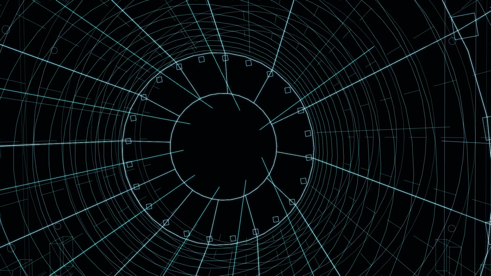
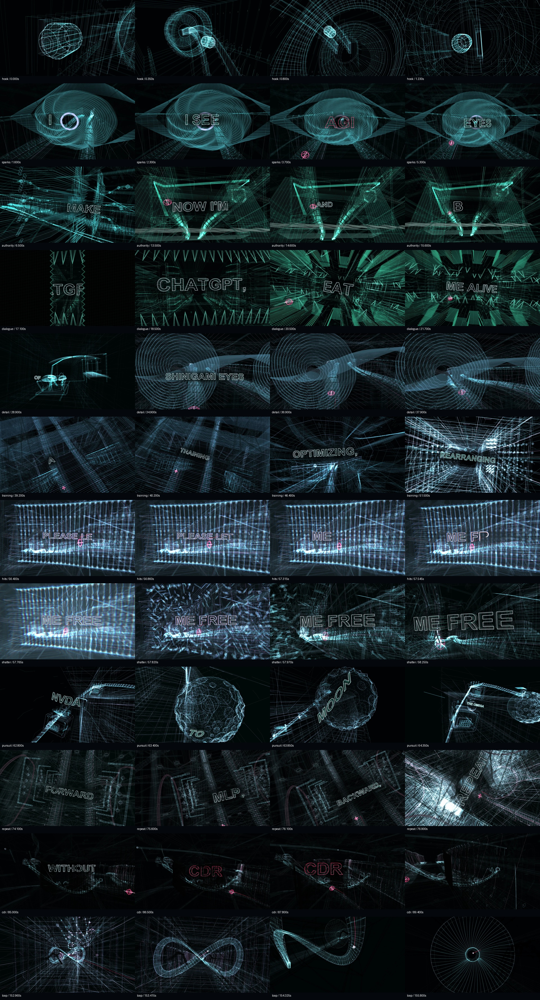

# I'm Upping My P(doom) — Kinetic Hook

**纯代码三维线稿 MV · 空间歌词 · FPV 穿越 · 语义隐喻**

A procedural 3D wireframe music video built with Python and ModernGL. Lyrics are physical geometry in the scene; the camera flies through words, machines and visual metaphors.



由 **炽阳001 / Chiyang001** 制作。当前版本为 **v19 · Kinetic Hook**：前奏从首帧开始，用四个快镜头完成点火；前半段加入随演唱词组变化的机位和无词近景。Repeat 用同轨前进、倒走与再次加速表现，CDR 重建为有前后关系的 Lisp 取尾机构，FREE 连续七次受击后全笼碎散。保留原版单眼、NVDA → Moon → Omega 实体跟拍和持续运动的无限环尾声。所有场景由代码线条与字形轮廓构造，无图片背景或预渲染场景素材。

## 画面设计

- **225 词空间歌词**：按演唱逐词描线，每次最多两个词；字形有厚度、骨架与细节，处于固定三维空间。
- **开场四镜头**：1.42 秒前奏内，火种沿导轨疾行、点亮线圈并进入机械虹膜。全部 43 帧逐帧检查，无空白或静止等待。
- **前半段节奏**：83 个演唱词组中，63 组启用新增机位；另四段无词近景持续推进。穿字、FREE 和月面追踪由专用镜头衔接。
- **18 段飞行、17 段实际穿字**：推进、俯冲、侧掠、上升与转向结合，四次爆炸落在 P(doom) 的歌词窗口。
- **词义成为场景**：14 段前半编排补充既有 16 段语义场面；逐词对应的对象、典故和解释边界见 [22 项前半覆盖研究](v17/first_half_coverage.md) 与沿用的 [39 项概念词典](v15/concept_lexicon.md)。
- **蘑菇袋与规则机器**：三株立体蘑菇装在敞口袋与承载台上，菌柄、菌褶、提手清楚可见；输送梁连接右侧分拣机，菌丝一次生长为上方拱顶。
- **算力登月跟拍**：摄影机追随同一载荷爬升、掠过真实月面凹坑，用 160 ms 跨越追向独立 Omega 核心。歌词安装在物件的固定局部表面。
- **FREE 连续重击**：六次预击逐步压弯金属，57.745 秒第七击让顶底横梁、侧架、栏杆和锁件全部变成 366 个机械碎片；镜头后坐后穿过碎片。
- **词义驱动运镜**：Forward / backward / repeat 沿同一神经轨道往返并重新启动；CDR 用共用弯曲桁架、CAR 首元素和 CDR 尾指针替代旧悬浮方块。
- **其他实体叙事**：分节机械蛇、控制关系倒转、训练活塞、优化轨、原子晶格、对话传递与局部检验工位共同丰富前半段。全部为代码线条，保留细线机械风格。
- **Transformer 多分镜**：五个插入机位依次观察 token、位置信息、Q/K/V、四头注意力、残差与前馈、纵深解码；同一词的演唱过程中，装置与镜头持续改变。
- **灾难长镜头与鼓点尾声**：Go 穿越包含色散、震动和结构坍塌；无歌词尾声沿 30 个鼓点穿过九组空间，单向推进 585 个世界单位。
- **动态片尾**：固定空间的扭转无限环、分离交叉层、同一火种与深层虹膜形成连续跟拍；运动延续至最后一帧，片尾不展示标题或署名。



## 快速复现

已验证环境：**Windows、Python 3.13、支持 OpenGL 3.3 的显卡**。目标成片为 1920×1080、30 fps、4700 帧，约 2 分 37 秒。渲染速度取决于显卡与 CPU，完整渲染会产生约 GB 级 MP4。

```powershell
git clone https://github.com/Chiyang001/Im-Upping-My-Pdoom.git
cd Im-Upping-My-Pdoom
python -m venv .venv
.\.venv\Scripts\python.exe -m pip install -r requirements.txt
```

先生成静帧分镜，**无需音频**：

```powershell
.\.venv\Scripts\python.exe v19/render.py --meaning-preview
```

结果保存到 `v19/meaning_storyboard.jpg` 及同目录单帧图片。字体默认寻找本机 Arial Bold，也可显式指定可用的 `.ttf` / `.otf` 文件。

渲染完整 MV，请自行提供与本项目时间轴匹配、可使用的原曲音频或视频（MP4 / M4A 中的 AAC 音轨）：

```powershell
.\.venv\Scripts\python.exe v19/render.py --audio "D:\Music\source.mp4"
```

默认输出：`output_v19/Im_Upping_My_Pdoom_Kinetic_Hook_1080p.mp4`。音轨使用 `-c:a copy`，不会重新压缩。歌曲、原片及成片音视频未随源码分发；输入音轨需适合直接复制到 MP4 容器。

先渲染一小段：

```powershell
.\.venv\Scripts\python.exe v19/render.py --audio "D:\Music\source.mp4" --sample 30 --duration 3 --output "output_v19/sample.mp4"
```

可配置 `--audio`、`--font`、`--output`、`--backend`，或设置 `PDOOM_AUDIO`、`PDOOM_FONT`、`PDOOM_OUTPUT`、`PDOOM_BACKEND` 环境变量。命令行参数优先；显式相对路径按启动命令的目录解析。`--help` 无需启动 GPU。

```powershell
python v19/render.py --help
python v19/render.py --font "C:\Windows\Fonts\arialbd.ttf" --meaning-preview
```

Linux 无显示服务时可以尝试 `--backend egl` 并指定系统字体；Linux / macOS 未做完整成片验收。字体替换会改变字宽和穿字构图，应重新检查歌词可读性。仓库不包含字体文件。

## 代码结构

本项目逐版迭代，最新版继续使用较早目录中的稳定模块，因此克隆时应保留完整目录结构。

| 位置 | 用途 |
| --- | --- |
| `v19/render.py`、`v19/render_options.py` | 最新渲染入口、基础摄影机与追踪隔离、编码 |
| `v19/hook_director.py` | 前奏四个镜头、导轨、点火线圈和机械虹膜 |
| `v19/meaning_camera.py`、`cdr_geometry.py` | 同轨反复运镜与 Lisp 取尾机构 |
| `v19/object_pursuit.py` | 载荷、月面与 Omega 的物件追踪及歌词安装面 |
| `v19/free_impact.py`、`infinity_finale.py` | 牢笼重击、位移与持续运动的无限环尾声 |
| `v19/first_half_score.py`、`first_half_director.py`、`first_half_geometry.py` | 14 段前半词义编排及实体机械 |
| `v19/organic_geometry.py`、`orbital_geometry.py` | 蘑菇袋、蛇、月面、算力和立体升轨 |
| `v19/semantic_score.py`、`semantic_director.py` | 沿用 16 段语义编排与 Transformer 多分镜 |
| `v19/integrated_semantics.py`、`cohesive_geometry.py` | 机械语义部件、GPU 机舱及通用安装件 |
| `v19/transformer_geometry.py` | Transformer 计算结构与前向、反向网络 |
| `v15/concept_lexicon.md`、`concept_lexicon.json` | 沿用的 39 项概念研究、时间与一手出处 |
| `v14/metaphor_geometry.py`、`metaphor_extra.py` | 沿用的九段隐喻线雕与时序动作 |
| `v19/flight_camera.py` | 穿字航线与摄影机数学 |
| `v13/` | Go 灾难动画、尾声长航线、字形细节 |
| `v10/`、`v11/`、`v12/` | 分镜、激进镜头与飞行空间 |
| `v9/` | 逐词编排、爆点与剪辑调度 |
| `v4/`、`v5/`、`v7/`、`v8/`、`code3d/` | 几何引擎、早期场景、世界层与摄影机基础 |
| `work/lyrics.json`、`work/transcript.json` | 歌词和逐词时间参考 |
| `code3d/rhythm_v3.json` | 检测节奏、鼓点与冲击数据 |
| `v11/compositions.json` | 最新渲染仍需读取的构图保护数据 |

早期制作与修正脚本一并保留作开发记录；其中部分历史脚本依赖未分发的图片、影音或额外分析工具。**复现最终版本请使用 `v19/render.py`**。核心依赖见 `requirements.txt`；重新做早期节奏分析或语音转录时，相关脚本还需 SciPy、faster-whisper 等可选依赖。

## 检查与制作记录

无需 GPU 的检查：

```powershell
python -m compileall -q code3d work v4 v5 v6 v7 v8 v9 v10 v11 v12 v13 v14 v15 v16 v17 v19
python v19/audit_words.py
python v19/flight_camera.py
```

空间可读性与实际飞行检查需要字体和 OpenGL：

```powershell
python v19/qa_preserved_scenes.py
python v19/qa_spatial_words.py v19
python v19/qa_actual_flights.py
```

225 词的原序、时序、最多两词、完整描线及空间可读性检查通过。18 段飞行中 17 段实际穿字，均先可读后越面且无反向回穿；新追踪没有重新跨过旧 P(doom) 字面。实际物件追踪的世界路径长 174.84 单位，三个方向均有显著平移。

完整 MP4 已渲染并通过全片解码与原 AAC 位流一致性检查。294 个事件各提取七帧；48 张整合编码抽样及前奏 43 帧、FREE 24 帧、Repeat / CDR 16 帧的专项复核通过。最后 62 帧全部不同，最后八帧也持续运动。七张未修改后半段及尾声原始 RGB 抽样帧与 v18 完全相同；单眼造型保留，构图随新机位变化。具体检查范围与制作记录见 [v19 制作说明](v19/README.md)。

上述数字对应制作时的原字体和原时序，修改字体或时序后需要重新验收。详细调整见 [v19 制作说明](v19/README.md)；一手概念来源仍见 [v15 概念词典](v15/concept_lexicon.md)；历史本地成片记录见 [制作历史](docs/LOCAL_RENDER_HISTORY.md)。生成日志、QA 大表、影音和帧图默认由 `.gitignore` 排除。

## 开源与作者

原创代码与原创文档采用 [MIT License](LICENSE)。歌曲、歌词、录音、字体和第三方依赖的权利说明见 [THIRD_PARTY_NOTICES.md](THIRD_PARTY_NOTICES.md)。

**炽阳001 / Chiyang001**

- [Bilibili](https://space.bilibili.com/404891612)
- [GitHub](https://github.com/Chiyang001?tab=repositories)
